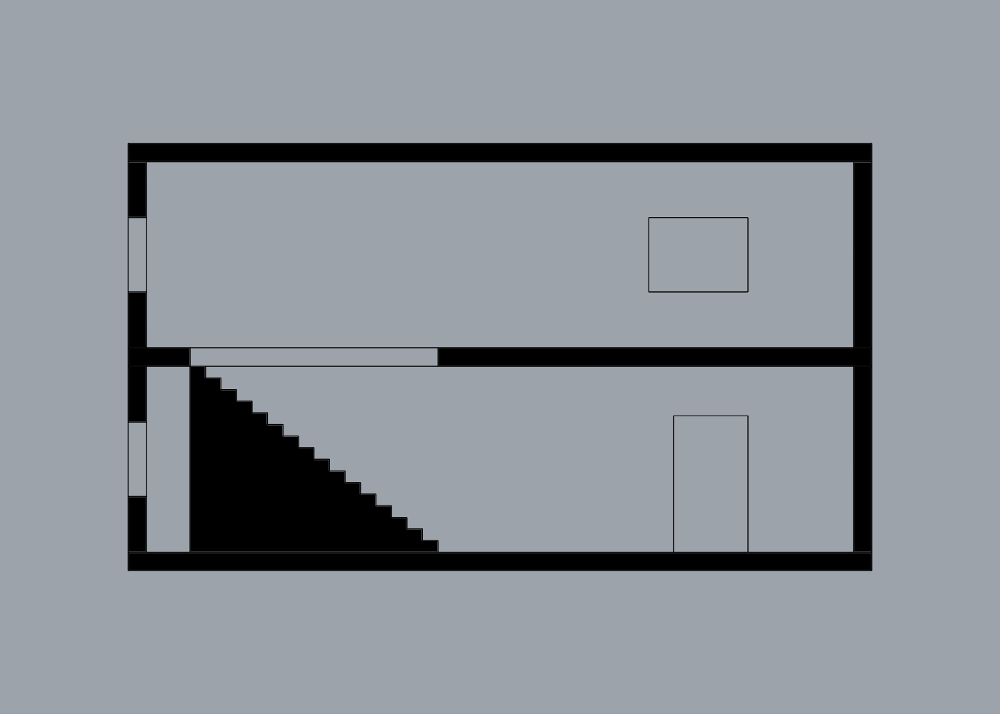

# RhinoMCP

**An MCP server that lets AI agents work inside Rhino 7 for Mac:** model, organize layers, measure, check, and produce clean drawings at scale.

A personal research project, built to find out how far an agent can drive Rhino 7 on an Intel/Rosetta Mac. The answer is in [`docs/FINDINGS.md`](docs/FINDINGS.md).

| Photo → model (carabiner, Opus 5.5 agent) | Clean section at 1:100 (`drawing_make2d`) |
|---|---|
|  |  |

## Highlights
- **Runs inside Rhino 7.** A C# plugin serves MCP on `127.0.0.1` with a token. A small native bridge connects stdio clients. Users need no Python, Node or .NET.
- **52 tools.** They cover objects and named sets, layers and layer schemes, geometry, freeform surfaces and SubD, measurement and clash checks, views, clean Make2D, layouts and export, model overview, change log and audit, and scripting (IronPython 2.7 and C#).
- **Clean drawings.** Make2D output becomes lines and arcs on separate layers with ISO line weights, closed hatched sections and exact scale. Our 9 test drawings produced 120 curves; Rhino's native Make2D produced 320 NURBS for the same views.
- **Built for agents:**
  - one-call context, counts before lists, short object handles (`o17`) and named sets;
  - errors that suggest valid values;
  - one undo step per tool call;
  - commands that wait for input are cancelled and the prompt is returned to the agent;
  - dialogs that would freeze Rhino are blocked.
- **Aware of the hardware.** A resource guard refuses heavy surfaces, SubD levels, captures, booleans and Make2D jobs before they make Rhino 7 slow. Rhino 7 runs single-threaded under Rosetta here.
- **Skills included.** Seven agent skills cover efficient use, units and tolerances, geometry hygiene, layer standards, drawing production, massing and product design. They ship as a Claude Code plugin.
- **Tested live:** 217 integration tests against a running Rhino 7.39.

## Requirements
- macOS with **Rhino 7** (tested with 7.39, Intel build under Rosetta on Apple Silicon).
- An MCP client: Claude Code, Claude Desktop or Cursor.
- Building from source uses Rhino's bundled Mono and Roslyn compiler. Swift (Xcode Command Line Tools) is needed only for the bridge.

## Install
**From a release:** download the assets from the [latest release](../../releases/latest) and follow [`docs/INSTALL.md`](docs/INSTALL.md).

**From source:**
```sh
scripts/install.sh      # builds and installs the plugin, tools and bridge; prints client config lines
```
Restart Rhino 7 once. The server starts with Rhino; check it with the `MCPStatus` command.

**Connect a client:**
```sh
# Claude Code
claude mcp add -s user rhino -- "$HOME/Library/Application Support/RhinoMCP/bin/rhinomcp-bridge"
# Skills (Claude Code plugin)
claude plugin marketplace add joosthel/RhinoMCP && claude plugin install rhino-mcp@rhino-mcp
```
For Claude Desktop, double-click `rhino-mcp.mcpb`. Cursor setup, the Gatekeeper workaround for the unsigned binaries and troubleshooting are in [`docs/INSTALL.md`](docs/INSTALL.md).

## Using it
Ask your agent in plain language, with Rhino open:
- "Summarize the model and audit the layers against AIA naming."
- "Cut a plan at 1.2 m and a section through the stair, 1:100, put both on an A2 sheet and export PDF and DXF."
- "Model this part from the photo: basic outline first, then fillets and the engraving."
- "Check clearances between the furniture and walls; list clashes over 5 mm."

The agent starts with `context_get` and verifies with numbers (`measure`, `geometry_validate`, `clash_check`). It uses `view_capture` only for visual checks.

## Tools at a glance
| Area | Tools |
|---|---|
| Context & model | `context_get`, `model_overview`, `model_changes`, `verify_audit`, `system_status`, `performance_mode` |
| Objects | `objects_query`, `objects_get`, `objects_set_props`, `objects_delete`, `objects_select`, `objects_near`, `sets_save/list/delete` |
| Layers | `layers_list`, `layers_manage`, `layers_audit`, `layers_apply_scheme`, `layers_move_objects` |
| Geometry | `geometry_create`, `geometry_transform`, `geometry_boolean`, `geometry_edit`, `geometry_validate` |
| Freeform | `freeform_surface`, `subd`, `analyze_surface`, `analyze_continuity` |
| Measure | `measure`, `measure_distance`, `clash_check` |
| Views | `view_capture`, `view_capture_sheet`, `view_set`, `views_named` |
| Drawings | `drawing_make2d`, `drawing_clipping_plane`, `layout_create`, `layouts_list`, `layout_delete`, `annotate`, `export` |
| Scripting | `run_python`, `run_csharp`, `run_command`, `command_cancel`, `commands_search`, `history_undo/redo` |

## How it works
```
Claude Code / Desktop / Cursor ── stdio ── rhinomcp-bridge (Swift) ──┐
                                 (or Streamable HTTP directly) ──────┤ 127.0.0.1:7340/mcp, Bearer token
                                                                     ▼
          Rhino 7 ── RhinoMCP.rhp (core: server, registry, UI-thread dispatch, undo, auth)
                       └─ RhinoMCP.Tools.*.dll (all tools; hot-reloadable in development)
```
Details are in [`docs/ARCHITECTURE.md`](docs/ARCHITECTURE.md). It also records every Rhino 7 Mac quirk the project ran into.

## Documentation
| | |
|---|---|
| [FINDINGS](docs/FINDINGS.md) | What works, where it breaks, lessons, gaps |
| [INSTALL](docs/INSTALL.md) | Install, connect, troubleshoot |
| [ARCHITECTURE](docs/ARCHITECTURE.md) | Design, tool contract, learned quirks |
| [DEVELOPMENT](docs/DEVELOPMENT.md) | Build, dev loop, writing tools, tests |
| [PLAN](docs/PLAN.md) · [DECISIONS](docs/DECISIONS.md) | Milestones and owner decisions |
| [Evaluations](docs/eval/) | [freeform](docs/eval/freeform/REPORT.md) · [drawing](docs/eval/drawing/REPORT.md) · [layout](docs/eval/layout/REPORT.md) · [scale](docs/eval/scale/REPORT.md) · [sculpture rebuild](docs/eval/rebuild/REPORT.md) · [carabiner](docs/eval/carabiner/REPORT.md) |
| [Research](docs/research/) | 11 research notes behind the design ([synthesis](docs/research/00-synthesis.md)) |
| [Skills](skills/) | Agent skills (Claude Code plugin) |

## Status and limits
- **v0.2.0, research prototype.** Rhino 8 and Windows are not supported yet; the design allows a later net8.0 build.
- **Unsigned binaries.** macOS may block the bridge on first run; see [`docs/INSTALL.md`](docs/INSTALL.md).
- **Captures** briefly drive the active viewport, and the Rhino window must be visible.
- **Next on the list:** photo matching, Grasshopper definitions as tools, a Python 3 sidecar, a background job system. See [FINDINGS → What's still missing](docs/FINDINGS.md#whats-still-missing-ranked).

## License
[MIT](LICENSE) © 2026 Joost Helfers. Rhino is a product of Robert McNeel & Associates. This project references Rhino's assemblies but does not redistribute them.
