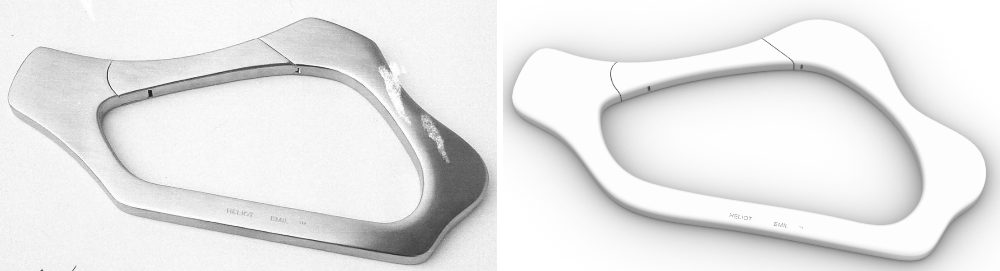

# Carabiner hoop: basic shapes first, details after

Agent: Opus 5.5 subagent, 2026-10-15, Rhino 7.39 Mac (Rosetta). Only the largest (lower) hoop was modelled, at the origin (plate on XY, z 0–7). Scripts and the full call log are in [`tests/eval_carabiner/`](../../../tests/eval_carabiner/).

## Result
- Two valid closed solids on `_mcp_eval::carabiner::final`, with 0 naked, non-manifold or tiny edges:
  - **body**: 153 faces, 41,761 mm³
  - **gate**: 24 faces, 6,211 mm³
- 200.4 × 110.6 × 7.0 mm, about 380 g in steel.
- **137 MCP calls, 4 failed** (none geometric). About 27 s of server time; the slowest call took 2.2 s.
- The only escape hatch used was two `run_command _Explode` calls, to turn text into curves.

## Owner correction: the front edge is straight
- **Outer outline:** an exact 90 mm `line` at y = −55.2 plus one clamped degree-3 curve with 18 control points. The 2nd and 2nd-to-last control points lie on the line, so both ends meet it with G1 continuity (`straight_fit.py`).
- **Inner outline:** a parallel 68 mm line plus a curve with 12 control points, so the band width stays constant.
- **Fit to the trace:** outer max 1.30 / mean 0.51 mm; inner max 0.99 / mean 0.43 mm.
- **Cost:** a full rebuild from the base, about 39 calls and about 10 s of server time.

## Breakdown
- **Basic shape (almost 2D):**
  - Outer outline: a flared left ear, a straight front, a hump behind the gate, and a lobed right end with an S-turn.
  - Rounded, roughly triangular opening.
  - Constant thickness.
- **Details, in order:**
  1. 2 mm edge rounding.
  2. Gate split by two hairline cuts: the left one curved, the right one straight. The gate is its own solid.
  3. Two latch notches.
  4. *(not modelled)* the bevel at the right split.
  5. "HELIOT EMIL ™" engraved 0.3 mm deep on the top face of the front band.

## Assumptions
- **Size:** 200 mm long (±25 %). The photo has no scale.
- **Thickness:** 7 mm. The edge face is about 20 px tall; 7 mm projects to 19.9 px.
- **Camera:** the print border carries no perspective, so a pinhole camera is assumed: f = 2,400 px, 55° elevation.
- **Camera check in Rhino:** the reference traces land within 1 px. Rhino's `lens` is measured against a **24 mm frame on the short side** of the capture.

## Build
| Phase | Steps |
|---|---|
| Basic | outline rounds 0–3 (round 3 = straight-edge correction) → 7 mm extrusion − inner cutter (z −1…8) in one boolean → check from the photo camera |
| Details | `fillet_edges` r 2 (0.7–0.9 s) → 2 gate slots + 2 notch boxes in one boolean (2 s, returns body + gate) → text → `_Explode` → 13 letter cutters → one boolean (2.2 s) |

A clean replay of the final path would take about 40 calls.

## Geometry
- Curves: outer has 21 control points, inner 15.
- Final solids: body 2,258 control points, gate 1,678. The largest face has 477 control points (a fillet strip), and nothing exceeds the 2,500 limit.
- No kinks. Minimum radius 2.0 mm (fillets), and 0.54 mm at the letter walls.

## Fidelity
- **Matches:**
  - outline and opening within a few px, including the straight front band
  - proportions
  - the soft edge roll
  - both gate splits, the notch positions and the text placement
- **Doesn't match:**
  - The ear and lobe corners are up to 1.3 mm too soft.
  - Thickness, radius and scale are assumed.
  - The notches are slightly small.
  - The bevel next to the right split is missing.
  - The text uses the default font.
  - No hinge hardware.

## Compared with the sculpture rebuild
| | Sculpture | Carabiner |
|---|---|---|
| MCP calls | 368 (14 failed) | 137 (4 failed, including a full correction rebuild) |
| Slowest call | 54–90 s, timeouts | 2.2 s |
| Densest face | 44×57 control points | 477 control points |

This run followed the near-2D nature of the object: light planar curves, one extrusion and one boolean, then small separate detail cutters. As before, the photo analysis happened outside the server.

## Tool gaps (ranked)
1. **`view_capture`** ignores `display_mode` unless the viewport is already in that mode. `Arctic` is listed but rejected.
2. **No text → curves,** and no engrave or emboss operation.
3. **Curves:**
   - no closed control-point curve
   - no end-tangent constraints
   - no fillet for polyline corners
   - no "line + blend" helper
4. **Extrusion:** the direction follows the curve orientation, and the reported bbox is loose.
5. **`history_undo`** silently ignored an unknown argument (`count` instead of `steps`).
6. **`objects_query`** layer and name filters were ignored in one case.
7. **`system_status`** counts deleted objects.
8. **No photo-matching or back-projection helper.**
9. **`fillet_edges`** has no `budget_ms`.
10. **`zoom_to` on Top** leaves large margins.
