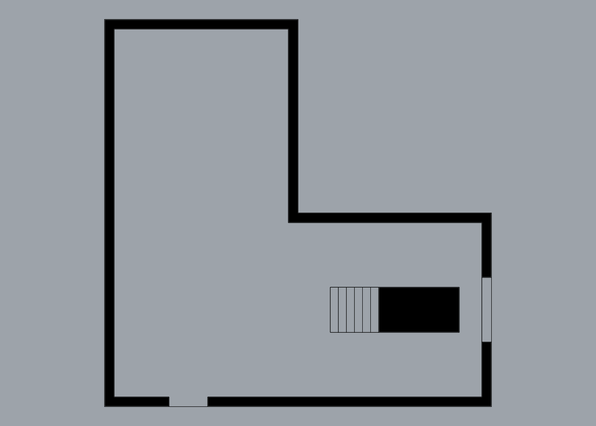

# Evaluation: `drawing_make2d` on a building and a product

Generated by `tests/eval_drawing.py` on Rhino 7.39 Mac, 2026-10-15. Raw numbers are in [`results.json`](results.json).

## Subjects
- **Building:** a two-storey L-shaped massing with a 12 × 12 m footprint, 3.0 m storeys and 0.3 m slabs. It has six solids:
  - ground slab, first-floor slab (with a stair void), roof slab;
  - two wall rings, each with a door and a window cut by `geometry_boolean`;
  - a 16-step solid stair.

  Drawn at 1:100.
- **Product:** the freeform vase (two lofts of 7 circles, outer minus inner). Drawn at 1:2.

| Plan, cut at z = 1.2 m | Section, y = 3 m |
|---|---|
|  |  |

Other images: `model.png`, `elevation.png`, `elevation_east.png`, `elevation_hidden.png`, `vase_elevation.png`, `vase_section.png`, `vase_section_on_seam.png`, `vase_plan.png`.

## Ours vs Rhino's native Make2D
| Drawing | Curves (ours) | Curves (native) | Closed section loops / hatches (ours) | Open ends (ours / native) |
|---|---|---|---|---|
| Building plan, z = 1.2 m | 12 (8 lines, 4 polylines) | 63 NURBS | 3 / 3 | 0 / 0 |
| Building section, y = 3 m | 19 | 79 NURBS | 11 / 11 | 0 / 0 |
| South elevation | 14 | 24 NURBS | – | 0 / 0 |
| East elevation | 18 | 37 NURBS | – | 0 / 0 |
| South elevation, hidden + tangent | 48 | 87 NURBS | – | 0 / 0 |
| Vase elevation | 1 NURBS | 4 NURBS | – | 0 / 0 |
| Vase section | 2 (1 line, 1 NURBS) | 10 NURBS | 1 / 1 | 0 / 0 |
| Vase section on the seam | 2 | 12 NURBS | 1 / 1 | 0 / 0 |
| Vase plan | 4 arcs | 4 NURBS | – | 0 / 0 |

- **Totals:** 120 curves (ours) vs 320 (native). Native Make2D returns every curve as an unjoined NURBS and creates no loops or hatches. Our pipeline emits a NURBS curve only where no line or arc fits.
- **Scale:** every 1:100 drawing measures 120.0 mm for the 12 m footprint, and `scale_check` is ok everywhere.
- **Open ends:** 0 on both sides, so this metric doesn't separate the two.
- **Overlaps:** `overlaps_removed` is 0 on solids, because Rhino already de-duplicates there. The overlap pass did real work on the vase sections (2 and 10 pieces removed).
- **Time:** 0.4–0.6 s per drawing. Almost all of it is Rhino's hidden-line engine; our steps take 15–70 ms.

## What's still messy
1. Silhouette and visible edges default to the same 0.35 mm weight, so outlines don't stand out. Override with `layer_scheme`.
2. Hatches default to solid poché. There's no per-material choice and no alternating angles. Each solid gets its own hatch.
3. Coincident section lines at wall/slab joints are kept on purpose, so each solid has its own closed loop. That costs two coincident lines per joint.
4. Openings are bare cut edges: no door swings, glazing or sills.
5. The split between silhouette and visible edges follows Rhino's `IsSceneSilhouette`. That isn't always what a drafter would call the outline.
6. Partly overlapping free-form curves are only removed when one lies fully on the other. Lines and arcs are trimmed exactly.
7. Mesh sources stay jagged. They trigger a warning and are counted in `mesh_sources`.
8. Perspective views work but are flagged, and scale is meaningless there.
9. Each drawing runs as a single UI-thread call. A very large model can exceed the 60 s dispatcher limit, and there's no job fallback yet.
10. `compare_native` briefly drives the active viewport and restores it, and deletes the native output and its layers. It can't reset Rhino's sticky Make2D options.
11. Drawings sit at scale next to the model. Putting them on sheets is the job of `layout_create` and `export`.
