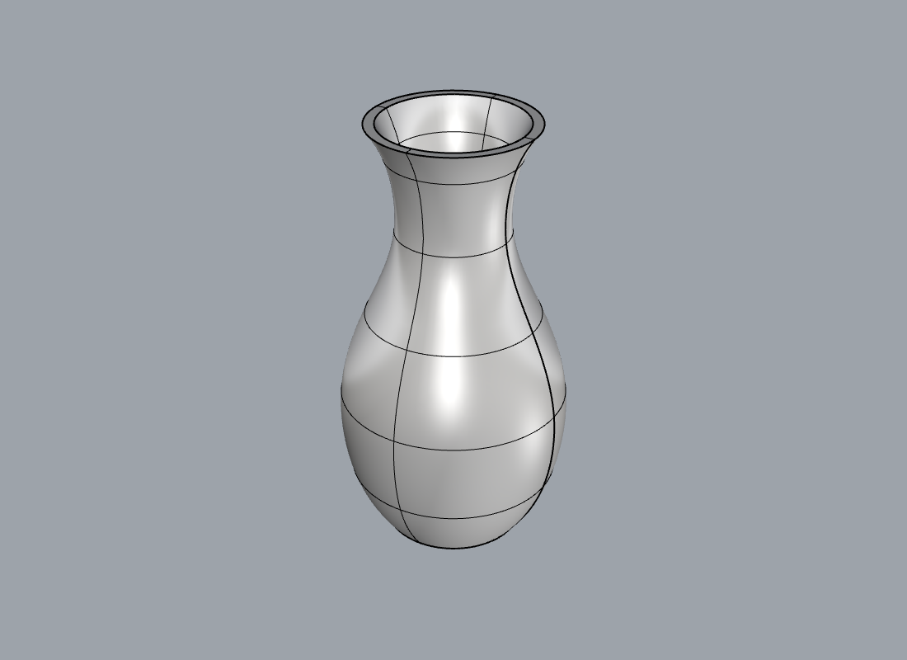
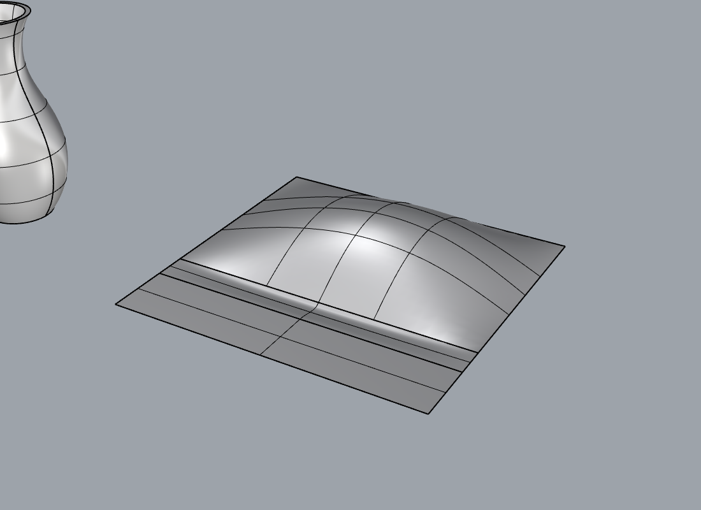
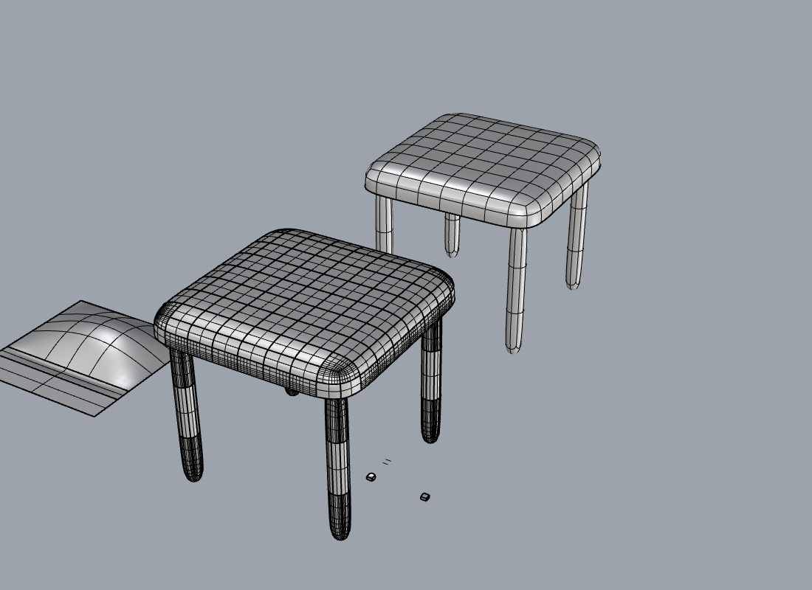

# Freeform tools: evaluation on three real shapes

Generated by `tests/eval_freeform.py` (run inside the shared-Rhino lock via `scripts/dev-test.sh`). Every shape was built **only through MCP tool calls**; the objects stay in the document on layer `_mcp_eval::freeform`.

Tools used for modelling: `freeform_surface`, `subd`, `analyze_surface`, `analyze_continuity`, plus existing `geometry_boolean`, `geometry_transform`, `measure`, `geometry_validate`. `run_command` calls that only select/zoom/capture are not counted as modelling calls.

| shape | modelling calls | failed calls |
|---|---|---|
| vase | 5 | 0 |
| hood | 17 | 0 |
| stool | 15 | 0 |

## vase



Numbers:

```json
{
 "outer": {
  "handle": "o1941",
  "solid": true,
  "volume": 1035813.975517,
  "area": 60110.273233,
  "faces": 3
 },
 "max_abs_curvature": {
  "value": 0.039216597,
  "min_radius": 25.499408,
  "at": [
   -24.728253,
   6.223161,
   158.384142
  ]
 },
 "gaussian": {
  "min": -0.000571567,
  "max": 0.000245716,
  "avg": -2.3387e-05,
  "min_at": {
   "point": [
    -25.313967,
    6.370562,
    149.183702
   ],
   "uv": [
    172.6676,
    202.1095
   ],
   "face": 0
  },
  "max_at": {
   "point": [
    39.999912,
    -10.066456,
    13.874576
   ],
   "uv": [
    19.1853,
    422.5926
   ],
   "face": 0
  }
 },
 "mean_curvature": {
  "min": 0.0,
  "max": 0.016414332,
  "avg": 0.005333628,
  "min_at": {
   "point": [
    -35.53,
    -12.92,
    200.0
   ],
   "uv": [
    -73.53,
    -12.92
   ],
   "face": 1
  },
  "max_at": {
   "point": [
    39.999912,
    -10.066456,
    13.874576
   ],
   "uv": [
    19.1853,
    422.5926
   ],
   "face": 0
  }
 },
 "faces_outer": 3,
 "boolean": {
  "created": [
   "o1943"
  ],
  "solid": true,
  "volume_a": 1035813.975517,
  "volume_b": 897199.487907,
  "volume_result": 157386.199318,
  "step_used": "document_tolerance",
  "bbox": {
   "min": [
    -52.473437,
    -52.473437,
    0.0
   ],
   "max": [
    52.473437,
    52.473437,
    200.0
   ]
  }
 },
 "boolean_raw_keys": [
  "bbox",
  "created",
  "deleted",
  "op",
  "solid",
  "step_used",
  "volume_a",
  "volume_b",
  "volume_result"
 ],
 "measure": {
  "count": 1,
  "measured": 1,
  "totals": {
   "count": 1,
   "length": 0.0,
   "length_objects": 0,
   "area": 106846.863803,
   "area_objects": 1,
   "volume": 157386.199318,
   "volume_objects": 1,
   "centroid": [
    0.0,
    0.0,
    83.473734
   ],
   "centroid_basis": "volume",
   "bbox": {
    "min": [
     -52.473437,
     -52.473437,
     0.0
    ],
    "max": [
     52.473437,
     52.473437,
     200.0
    ]
   }
  },
  "units": {
   "length": "Millimeters",
   "area": "Millimeters^2",
   "volume": "Millimeters^3"
  },
  "objects": [
   {
    "handle": "o1943",
    "type": "Brep",
    "layer": "_mcp_eval::freeform",
    "area": 106846.863803,
    "volume": 157386.199318,
    "centroid": [
     0.0,
     0.0,
     83.473734
    ]
   }
  ]
 },
 "validate": {
  "summary": {
   "valid": 1,
   "invalid": 0,
   "with_problems": 0,
   "with_naked_edges": 0,
   "with_non_manifold_edges": 0,
   "with_tiny_edges": 0,
   "open_breps_not_solid": 0,
   "tiny_threshold": 0.002,
   "checked": 1
  },
  "total": 1,
  "returned": 1,
  "objects": [
   {
    "handle": "o1943",
    "type": "Brep",
    "valid": true,
    "faces": 5,
    "edges": 6,
    "naked_edges": 0,
    "non_manifold_edges": 0,
    "tiny_edges": 0,
    "solid": true,
    "closed": true,
    "volume": 157386.199318,
    "area": 106846.863803,
    "issues": [],
    "layer": "_mcp_eval::freeform"
   }
  ]
 },
 "image": "vase.png"
}
```

Tool calls:

1. `freeform_surface` - loft outer + inner profile circles (7 each), capped
2. `analyze_surface` - curvature of the outer shell
3. `geometry_boolean` - hollow the vase (open top, closed bottom)
4. `measure` - measure the hollow vase
5. `geometry_validate` - validate the result

## hood



Numbers:

```json
{
 "panel": {
  "handle": "o1944",
  "area": 64753.60964,
  "degree_u": 3,
  "degree_v": 3,
  "cp_u": 7,
  "cp_v": 7,
  "kinks_u": 0,
  "kinks_v": 0,
  "bbox": {
   "min": [
    200.0,
    0.0,
    0.0
   ],
   "max": [
    500.0,
    200.0,
    42.216856
   ]
  }
 },
 "max_abs_curvature": {
  "value": 0.009722222,
  "min_radius": 102.857143,
  "at": [
   500.0,
   0.0,
   0.0
  ]
 },
 "gaussian": {
  "min": -9.4522e-05,
  "max": 4.5481e-05,
  "avg": 7.26e-06,
  "min_at": {
   "point": [
    500.0,
    0.0,
    0.0
   ],
   "uv": [
    4.0,
    0.0
   ],
   "face": 0
  },
  "max_at": {
   "point": [
    366.820988,
    105.568416,
    42.065496
   ],
   "uv": [
    2.3333,
    2.1667
   ],
   "face": 0
  }
 },
 "mean_curvature": {
  "min": -0.007194202,
  "max": 0.0,
  "avg": -0.003521059,
  "min_at": {
   "point": [
    366.820988,
    88.786008,
    41.620209
   ],
   "uv": [
    2.3333,
    1.6667
   ],
   "face": 0
  },
  "max_at": {
   "point": [
    200.0,
    0.0,
    0.0
   ],
   "uv": [
    0.0,
    0.0
   ],
   "face": 0
  }
 },
 "edge_panel": 0,
 "edge_flange": 2,
 "baseline": {
  "class": "none",
  "max_gap": 30.0,
  "max_angle_deg": 36.1215,
  "max_curv_diff_pct": 100.0,
  "max_curv_diff_abs": 0.0015396,
  "samples": 21,
  "edge_a": {
   "target": "o1944",
   "face": 0,
   "edge": 0,
   "length": 300.0
  },
  "edge_b": {
   "target": "o1945",
   "face": 0,
   "edge": 2,
   "length": 300.0
  },
  "same_object": false,
  "worst": {
   "t": 0.55,
   "at": [
    360.033333,
    0.0,
    0.0
   ],
   "gap": 30.0,
   "angle_deg": 36.1215,
   "curv_diff_pct": 100.0,
   "curvature_a": -0.001538571,
   "curvature_b": 0.0
  },
  "thresholds": {
   "g0_gap_max": 0.001,
   "g1_angle_deg_max": 1.0,
   "g2_curv_diff_pct_max": 10.0,
   "note": "G0: gap <= g0; G1: also angle <= g1; G2: also curvature difference <= g2 percent"
  }
 },
 "blends": {
  "G1": {
   "handle": "o1946",
   "area": 9084.691235,
   "panel_vs_blend": {
    "class": "G1",
    "max_gap": 0.0,
    "max_angle_deg": 0.595,
    "max_curv_diff_pct": 101.7168,
    "max_curv_diff_abs": 0.132456922,
    "samples": 41,
    "edge_a": {
     "target": "o1944",
     "face": 0,
     "edge": 0,
     "length": 300.0
    },
    "edge_b": {
     "target": "o1946",
     "face": 0,
     "edge": 0,
     "length": 300.0
    },
    "same_object": false,
    "worst": {
     "t": 0.925,
     "at": [
      461.1875,
      0.0,
      0.0
     ],
     "gap": 0.0,
     "angle_deg": 0.5511,
     "curv_diff_pct": 101.4484,
     "curvature_a": -0.001169445,
     "curvature_b": 0.080742069
    },
    "thresholds": {
     "g0_gap_max": 0.001,
     "g1_angle_deg_max": 1.0,
     "g2_curv_diff_pct_max": 10.0,
     "note": "G0: gap <= g0; G1: also angle <= g1; G2: also curvature difference <= g2 percent"
    }
   },
   "blend_vs_flange": {
    "class": "G1",
    "max_gap": 0.0,
    "max_angle_deg": 0.0,
    "max_curv_diff_pct": 100.0,
    "max_curv_diff_abs": 0.05034157,
    "samples": 41,
    "edge_a": {
     "target": "o1946",
     "face": 0,
     "edge": 2,
     "length": 300.0
    },
    "edge_b": {
     "target": "o1945",
     "face": 0,
     "edge": 2,
     "length": 300.0
    },
    "same_object": false,
    "worst": {
     "t": 0.025,
     "at": [
      492.500056,
      -30.0,
      0.0
     ],
     "gap": 0.0,
     "angle_deg": 0.0,
     "curv_diff_pct": 100.0,
     "curvature_a": 0.005620628,
     "curvature_b": 0.0
    },
    "thresholds": {
     "g0_gap_max": 0.001,
     "g1_angle_deg_max": 1.0,
     "g2_curv_diff_pct_max": 10.0,
     "note": "G0: gap <= g0; G1: also angle <= g1; G2: also curvature difference <= g2 percent"
    }
   },
   "cp": [
    4,
    4
   ]
  },
  "G2": {
   "handle": "o1947",
   "area": 9125.516271,
   "panel_vs_blend": {
    "class": "G1",
    "max_gap": 0.0,
    "max_angle_deg": 0.595,
    "max_curv_diff_pct": 196.2667,
    "max_curv_diff_abs": 0.011199682,
    "samples": 41,
    "edge_a": {
     "target": "o1944",
     "face": 0,
     "edge": 0,
     "length": 300.0
    },
    "edge_b": {
     "target": "o1947",
     "face": 0,
     "edge": 0,
     "length": 300.0
    },
    "same_object": false,
    "worst": {
     "t": 0.175,
     "at": [
      275.395833,
      0.0,
      0.0
     ],
     "gap": 0.0,
     "angle_deg": 0.2365,
     "curv_diff_pct": 196.2667,
     "curvature_a": -0.001396108,
     "curvature_b": 0.001343987
    },
    "thresholds": {
     "g0_gap_max": 0.001,
     "g1_angle_deg_max": 1.0,
     "g2_curv_diff_pct_max": 10.0,
     "note": "G0: gap <= g0; G1: also angle <= g1; G2: also curvature difference <= g2 percent"
    }
   },
   "blend_vs_flange": {
    "class": "G2",
    "max_gap": 0.0,
    "max_angle_deg": 0.0,
    "max_curv_diff_pct": 0.0,
    "max_curv_diff_abs": 0.0,
    "samples": 41,
    "edge_a": {
     "target": "o1947",
     "face": 0,
     "edge": 2,
     "length": 300.0
    },
    "edge_b": {
     "target": "o1945",
     "face": 0,
     "edge": 2,
     "length": 300.0
    },
    "same_object": false,
    "worst": {
     "t": 0.15,
     "at": [
      455.000233,
      -30.0,
      0.0
     ],
     "gap": 0.0,
     "angle_deg": 0.0,
     "curv_diff_pct": 0.0,
     "curvature_a": 0.0,
     "curvature_b": 0.0
    },
    "thresholds": {
     "g0_gap_max": 0.001,
     "g1_angle_deg_max": 1.0,
     "g2_curv_diff_pct_max": 10.0,
     "note": "G0: gap <= g0; G1: also angle <= g1; G2: also curvature difference <= g2 percent"
    }
   },
   "cp": [
    4,
    6
   ]
  }
 },
 "network_g2": {
  "handle": "o1948",
  "panel_vs_network": {
   "class": "G1",
   "max_gap": 0.0,
   "max_angle_deg": 0.5048,
   "max_curv_diff_pct": 101.8831,
   "max_curv_diff_abs": 0.138224454,
   "samples": 41,
   "edge_a": {
    "target": "o1944",
    "face": 0,
    "edge": 0,
    "length": 300.0
   },
   "edge_b": {
    "target": "o1948",
    "face": 0,
    "edge": 0,
    "length": 300.0
   },
   "same_object": false,
   "worst": {
    "t": 0.025,
    "at": [
     214.270833,
     0.0,
     0.0
    ],
    "gap": 0.0,
 
```

Tool calls:

1. `freeform_surface` - panel from a 7x7 control-point grid (double curvature) + flat flange
2. `analyze_surface` - panel curvature + edge list
3. `analyze_surface` - flange edge list
4. `analyze_continuity` - baseline: panel vs flange (30 mm apart)
5. `freeform_surface` - blend panel edge to flange, G1
6. `analyze_continuity` - panel vs blend (G1)
7. `analyze_continuity` - blend vs flange (G1)
8. `freeform_surface` - blend panel edge to flange, G2
9. `analyze_continuity` - panel vs blend (G2)
10. `analyze_continuity` - blend vs flange (G2)
11. `freeform_surface` - alternative: network between the two edges, curvature continuity
12. `analyze_continuity` - panel vs network
13. `analyze_continuity` - network vs flange
14. `run_command` 
15. `run_command` 
16. `run_command` 
17. `run_command` 

## stool



Numbers:

```json
{
 "seat_raw": {
  "faces": 48,
  "edges": 96,
  "vertices": 50,
  "is_solid": true
 },
 "seat_creased": {
  "tagged": 40,
  "faces": 48
 },
 "seat_subdivided": {
  "faces": 192,
  "is_solid": true
 },
 "leg_copy_keys": [
  "bbox",
  "by_source",
  "count",
  "created",
  "op"
 ],
 "leg_count": 4,
 "breps": {
  "seat": {
   "handle": "o1956",
   "solid": true,
   "faces": 192,
   "volume": 5864705.859028,
   "naked_edges": 0
  },
  "leg0": {
   "handle": "o1957",
   "solid": true,
   "faces": 32,
   "volume": 215612.746623,
   "naked_edges": 0
  },
  "leg1": {
   "handle": "o1958",
   "solid": true,
   "faces": 32,
   "volume": 215612.746623,
   "naked_edges": 0
  },
  "leg2": {
   "handle": "o1959",
   "solid": true,
   "faces": 32,
   "volume": 215612.746623,
   "naked_edges": 0
  },
  "leg3": {
   "handle": "o1960",
   "solid": true,
   "faces": 32,
   "volume": 215612.746623,
   "naked_edges": 0
  }
 },
 "union": {
  "created": [
   "o1961"
  ],
  "solid": true,
  "volume_a": 6727156.845521,
  "volume_result": 6722661.520645,
  "step_used": "document_tolerance",
  "bbox": {
   "min": [
    720.0,
    -180.0,
    0.0
   ],
   "max": [
    1080.0,
    180.0,
    330.0
   ]
  }
 },
 "measure": {
  "count": 6,
  "measured": 6,
  "totals": {
   "count": 6,
   "length": 0.0,
   "length_objects": 0,
   "area": 816323.982174,
   "area_objects": 6,
   "volume": 13449818.366165,
   "volume_objects": 6,
   "centroid": [
    900.0,
    0.0,
    282.927708
   ],
   "centroid_basis": "volume",
   "bbox": {
    "min": [
     720.0,
     -180.0,
     0.0
    ],
    "max": [
     1080.0,
     180.0,
     330.0
    ]
   }
  },
  "units": {
   "length": "Millimeters",
   "area": "Millimeters^2",
   "volume": "Millimeters^3"
  },
  "objects": [
   {
    "handle": "o1961",
    "type": "Brep",
    "layer": "_mcp_eval::freeform",
    "area": 406531.680353,
    "volume": 6722661.520645,
    "centroid": [
     900.0,
     0.0,
     282.928042
    ]
   },
   {
    "handle": "o1955",
    "type": "SubD",
    "layer": "_mcp_eval::freeform",
    "area": 28118.980761,
    "volume": 215612.746623,
    "centroid": [
     1040.0,
     140.0,
     142.5
    ]
   },
   {
    "handle": "o1954",
    "type": "SubD",
    "layer": "_mcp_eval::freeform",
    "area": 28118.980761,
    "volume": 215612.746623,
    "centroid": [
     760.0,
     140.0,
     142.5
    ]
   },
   {
    "handle": "o1953",
    "type": "SubD",
    "layer": "_mcp_eval::freeform",
    "area": 28118.980761,
    "volume": 215612.746623,
    "centroid": [
     1040.0,
     -140.0,
     142.5
    ]
   },
   {
    "handle": "o1952",
    "type": "SubD",
    "layer": "_mcp_eval::freeform",
    "area": 28118.980761,
    "volume": 215612.746623,
    "centroid": [
     760.0,
     -140.0,
     142.5
    ]
   }
  ],
  "objects_truncated": true
 },
 "validate": {
  "summary": {
   "valid": 6,
   "invalid": 0,
   "with_problems": 0,
   "with_naked_edges": 0,
   "with_non_manifold_edges": 0,
   "with_tiny_edges": 0,
   "open_breps_not_solid": 0,
   "tiny_threshold": 0.002,
   "checked": 6
  },
  "total": 6,
  "returned": 6,
  "objects": [
   {
    "handle": "o1961",
    "type": "Brep",
    "valid": true,
    "faces": 320,
    "edges": 672,
    "naked_edges": 0,
    "non_manifold_edges": 0,
    "tiny_edges": 0,
    "solid": true,
    "closed": true,
    "volume": 6722661.520645,
    "area": 406531.680353,
    "issues": [],
    "layer": "_mcp_eval::freeform"
   },
   {
    "handle": "o1955",
    "type": "SubD",
    "valid": true,
    "issues": [],
    "layer": "_mcp_eval::freeform"
   },
   {
    "handle": "o1954",
    "type": "SubD",
    "valid": true,
    "issues": [],
    "layer": "_mcp_eval::freeform"
   },
   {
    "handle": "o1953",
    "type": "SubD",
    "valid": true,
    "issues": [],
    "layer": "_mcp_eval::freeform"
   },
   {
    "handle": "o1952",
    "type": "SubD",
    "valid": true,
    "issues": [],
    "layer": "_mcp_eval::freeform"
   },
   {
    "handle": "o1951",
    "type": "SubD",
    "valid": true,
    "issues": [],
    "layer": "_mcp_eval::freeform"
   }
  ]
 },
 "sources_moved": true,
 "image": "stool.png"
}
```

Tool calls:

1. `subd` - seat blob: SubD from a 4x4x1 box mesh
2. `subd` - crease the underside so the bottom stays flat
3. `subd` - subdivide once for a denser control net
4. `subd` - first leg: SubD cylinder
5. `geometry_transform` - copy leg to the 4 corners
6. `subd` - SubD -> NURBS brep: seat
7. `subd` - SubD -> NURBS brep: leg0
8. `subd` - SubD -> NURBS brep: leg1
9. `subd` - SubD -> NURBS brep: leg2
10. `subd` - SubD -> NURBS brep: leg3
11. `geometry_boolean` - union all parts into one solid
12. `measure` - measure result
13. `geometry_validate` - validate result
14. `geometry_transform` - move the SubD sources beside the union
15. `run_command` 

## Failures seen

None.

## Findings

### Results at a glance
- **Vase**: 7 profile circles per shell, lofted and capped, hollowed with one boolean. 5 calls, no failures. Height 200 mm, solid, closed bottom, open top. Max |principal curvature| 0.039 (min radius 25.5 mm) in the shoulder.
- **Hood**: double-curved 7x7 control-point panel + flat flange, joined by a blend. G1 blend: reaches **G1** on both sides (max normal angle 0.6 deg). G2 blend: **G2 on the flat flange side, only G1 on the panel side** (curvature difference up to ~196 percent along the edge). A network surface between the two brep edges with curvature continuity requested also only reached G1 (tangent honoured, curvature not). So true G2 against a doubly curved edge was **not** achieved with the R7 RhinoCommon calls; `analyze_continuity` made that visible with numbers instead of a misleading zebra image.
- **Stool**: SubD seat blob (box 4x4x1, underside creased, one subdivision) plus 4 SubD cylinder legs; each converted with `to_brep` and fused with one boolean union into a **solid** NURBS brep. The editable SubD cages sit beside it.

### What was hard for an agent
- **Edge addressing.** `blend_surface` and the network need edge indices. An agent has to call `analyze_surface` first just to learn them (that is why it lists edges). Natural-language "the edge at y=0" does not exist yet.
- **No SubD vertex editing and no SubD boolean in R7.** The only shaping levers are primitive choice, grid density, creases and offset. The stool needed 5 `to_brep` calls plus a union: `to_brep` takes one target per call (a candidate for a batch form).
- **G2 is not guaranteed.** Asking for G2 does not give G2 (see hood). The agent must verify and decide what to do; the tools report the class and the worst sample, but RhinoCommon offers no "add control points" switch for blends.
- **Loft input hygiene.** Seam alignment and direction are handled by `align:true`; inline point curves of 3 points needed degree 3 interpolation (degree 2 returned null in Rhino). Network curves must meet within `interior_tol`, otherwise the sorter fails with a terse code.
- **Closed bottoms.** `cap:true` caps both ends of a loft, so a hollow vessel needs the inner-loft-and-subtract pattern (one extra boolean).

### Rhino surprises
- `Curve.CreateInterpolatedCurve` with degree 2 and 3 points returns null; degree 3 works.
- `CreateBlendCurve` 8-argument form: `reverse` must equal "attached at the curve start" for both curves.
- `SubD.Vertices` has no enumerator (linked list via `First`/`Next`).
- `BlendContinuity` in R7 has only Position, Tangency and Curvature (no G3).
- `-_ViewCaptureToFile` options (`Width=`/`Height=`) must precede the file name or they are ignored (64x64 px); the `view_capture` tool is used when present.
- Curvature signs reported by `SurfaceCurvature` are not orientation-consistent across faces; `analyze_continuity` therefore derives the normal-section curvature from Su/Sv/Suu/Suv/Svv against a common normal (validated by analytic parabola tests).
