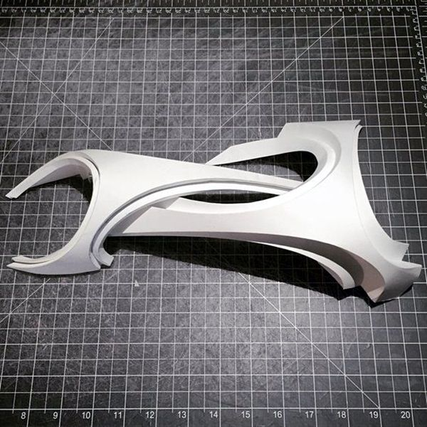
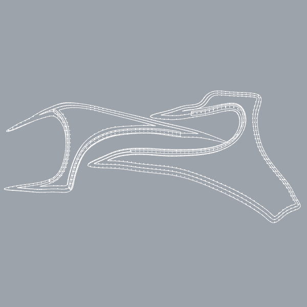

# Rebuild evaluation: two-element freeform sculpture

Agent: Opus 5.5 subagent, 2026-10-15, Rhino 7.39 Mac. **MCP tools only**: no `run_python`, `run_csharp` or `run_command`. Driver, data and the full call log are in [`tests/eval_rebuild/`](../../../tests/eval_rebuild/).

| Reference | Model, from the fitted photo camera |
|---|---|
|  |  |

Side by side: [`final_photo_cam_side_by_side.png`](final_photo_cam_side_by_side.png). Progress rounds: `progress_1/2/3_side_by_side.png`.

## Result
- Two **valid closed solids** on `_mcp_eval::rebuild::final`.
- The plan and silhouette match the photo closely. The camera was fitted to the mat grid at 0.9 px RMS.
- Heights, cross-sections and the contact between the parts are design guesses: a 70° top-down photo barely shows them.
- Known mismatch: the photo's tall, layered front walls are missing.

## 1. Breakdown
- **Camera.** Fitted from 60+ grid lines (`camera_fit.py`): 70° elevation, azimuth ≈ −3°, horizontal FOV 41°, about 480 mm above the mat.
- **Scale.** The ruler numbers sit two cells apart, so the mat is a **½-inch grid**. With 12.7 mm cells the length is ≈ 368 mm; with 1 cm cells it would be ≈ 290 mm. Modelled with 12.7 mm.
- **A – lower element** (rests on the mat): a hairpin band.
  - A pointed blade on the left runs under B.
  - A tri-cornered fin on the right rises to about 68 mm.
  - A raised top band returns to a free point.
  - The opening between the legs has a stepped rim.
- **B – upper element** (hovers): a crescent fork.
  - Two arms reach the mat on the left and form a C.
  - The body rises to about 75 mm and threads between A's legs.
  - Its tip lands on A's rim.
  - Stepped rib bands run along its concave edges.
- **Construction:** about 2 mm board sheets, laminated with stepped edges.

## 2. Dimensions (as modelled, mm)
| | X | Y | Z |
|---|---|---|---|
| Overall | 367.7 | 134.2 | 80.1 |
| A | 257 | 134 | 73 |
| B | 274 | 95 | 80 |

## 3. Strategy
1. Trace the outlines in photo pixels. Back-project them through the fitted camera onto a smooth designed height field (thin-plate RBF through about 20 controls per element).
2. Build the field surface with `freeform_surface through_points`: an 18×13 grid giving 13×18 control points, degree 3.
3. Make a three-sheet laminate:
   - inset the outline by 3 and 6 mm (`offset_curve`);
   - extrude the cutters and copy the field at +2 and +4 mm;
   - `split` each copy and delete the outer pieces;
   - `offset_surface` each piece into a 2.3 mm solid (0.3 mm overlap, so unions never meet coincident faces).
4. Rib bands: two 16-point rails → `loft` → `offset_surface` 1.5 mm.
5. `geometry_boolean union` per element, then notch A with B so that B's tip seats on A.

## 4. Rounds
| Round | What happened |
|---|---|
| 0 | Camera check: the overlaid grid and outlines coincide. Rhino's `lens` for a square capture is relative to the **24 mm frame height** (32.06 mm here). |
| 1 | First laminates. The outline matched, but the form was too flat (max 49 mm) and B had a bump. |
| 2 | Taller heights. The Front view showed wavy edges, caused by fixed-point back-projection on steep fields. |
| 3 | Root-solved lift, steep controls removed: smooth. |
| 4 | Rib bands added. The inner-C rib broke the booleans: **90 s timeouts** on union and on `clash_check`. Cause: a zig-zag ribbon from a per-point side test. |
| 5 | One offset side per rib and simplified ribs (40 → 16 points: thickening went from 23–31 s to 2.2 s). Clean rebuild: **59 calls, 0 failures, 31 s**. |

## 5. Final numbers
- `geometry_validate`: 2/2 valid, solid and closed, with 0 naked, non-manifold or tiny edges.
- A: 24 faces, **63,454 mm³**. B: 26 faces, **31,766 mm³**.
- A–B: `measure_distance` = 0. `clash_check` finds one contact (an 11.1 mm curve at B's tip, with no overlap volume). Everywhere else B hovers clear of A.
- Curvature: on the main sheets |K| ≤ 9e-4. The minimum radii (0.33 / 0.17 mm) are at the intentional creases and tips.
- **Control points:** the field surfaces have 13×18. After `offset_surface` the faces are much denser: **34×42 on A and 44×57 on B**, and the side walls reach 503×2. These exceed the guidance. They were left alone because rebuilding them would break the solids.

### Slow operations (> 10 s)
| Operation | Time |
|---|---|
| 40-point rib `offset_surface` | 23–31 s each |
| Union with the zig-zag rib | 54–90 s (4× client timeout) |
| `clash_check`, rib vs body | timeout at 90 s |
| Calls made right after a timeout | 30–70 s, while Rhino was still busy |
| Validate/measure with the heavy rib | 15–22 s |

After simplification, the checks take 4.5 s and the unions 5.5–6.5 s.

## 6. MCP calls
**Total 368, of which 14 failed.** The final clean build took 59 calls with 0 failures.

Busiest tools:

| Tool | Calls |
|---|---|
| `geometry_edit` | 96 |
| `objects_set_props` | 52 |
| `objects_delete` | 46 |
| `objects_get` | 34 |
| `view_capture` | 28 (4 failed) |
| `geometry_create` | 23 |
| `geometry_transform` | 22 |
| `geometry_boolean` | 17 (6 failed) |
| `freeform_surface` | 11 |

Causes of the 14 failures:
- rib booleans and clash checks: 7
- display-mode names: 3
- extrusion direction: 1
- `zoom_to` with a nested query: 1
- hidden objects excluded by `layers_move_objects`: 1
- a client-side null argument: 1

Side effect: `view_set` changed the user's Top viewport.

## 7. Fidelity
- **Matches:**
  - the outline of both parts from the photo camera, within a few px;
  - the two-element reading (fork and hairpin threaded through each other);
  - the proportions and the rise toward the middle and right;
  - the laminated edges and raised rib lips;
  - B hovering with a single tip contact.
- **Doesn't match:**
  - Heights and sections are guesses: ±20 mm of height moves the image by only about 10 px.
  - The tall fanned front walls are missing.
  - Steps run around all edges, but only on the concave edges in the photo.
  - The ribs are too small.
  - B's physical support is unknown.
  - The captures have no shadows.
- **Overall:** strong in plan and silhouette, medium in 3D form, weak in layered-edge detail.

## 8. What was hard for an agent
- **Inferring 3D from one steep photo.** The decisive step happened outside the server: camera fitting and back-projection in Python/scipy.
- **Unreliable visual verification:**
  - The same `display_mode` returned different looks between calls, and later Shaded and Rendered both came back as wireframe.
  - The camera can't be rolled.
  - `zoom_to` leaves large margins.
  - Unrelated objects showed up in the Right view.
- **Boolean hangs gave no diagnosis,** only a timeout.
- **Choosing which split piece to keep** needed an extra `objects_get` and bbox heuristics each time.

## 9. Tool gaps (ranked)
1. **Server-side time limits on booleans and intersections,** with a structured timeout and a diagnosis (self-intersecting input, near-tangency).
2. **Reliable `view_capture`:**
   - consistent display modes, and `Arctic` actually accepted;
   - `up`/`roll` and `fov_deg`;
   - tight `zoom_to` and an `only_layers` / isolate option;
   - `view_capture_sheet` with `zoom_to`, layer filter and labels.
3. **`split`/trim with a kept side** (`inside | outside | largest | containing_point`), plus project/pull curve to surface.
4. **Lighter `offset_surface` / `shell` output** (`max_cp` / rebuild), plus thicken both sides.
5. **Kink and self-crossing checks** on loft and sweep rails.
6. **Explicit extrusion direction,** with the direction used reported back.
7. **Consistent hidden-object handling** in `{query}` targets, via `include_hidden`.
8. **Photo-matching helper:** fit a camera from known ground-grid points and back-project pixel traces.
